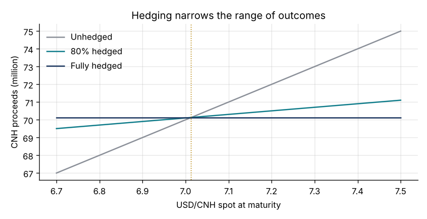
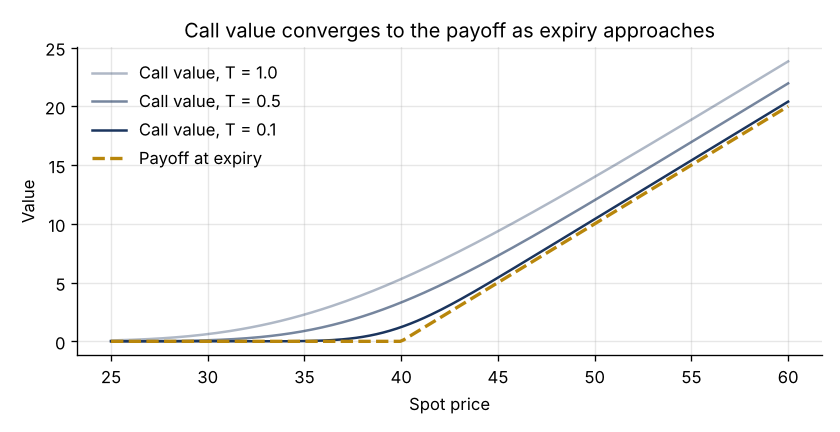
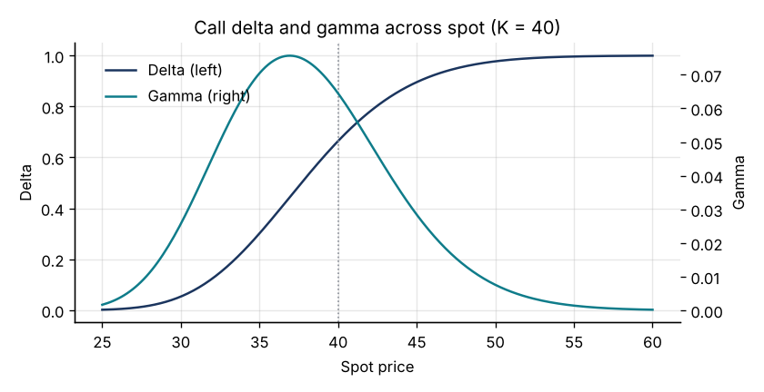
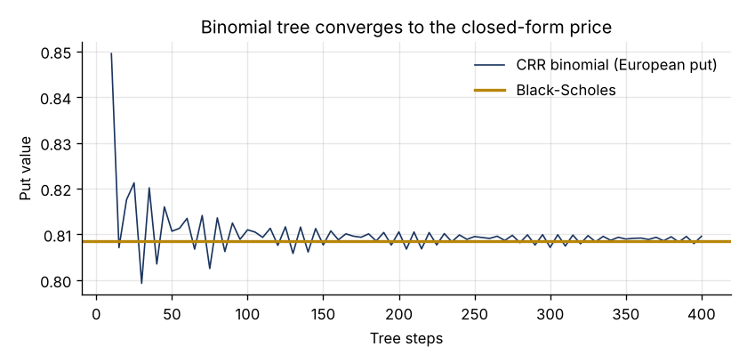
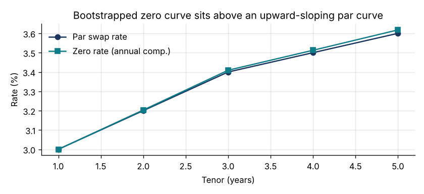

# Derivatives Valuation Toolkit

A small, tested Python library and walkthrough notebook for valuing the instruments I worked with on a securities firm's valuation and clearing desk and in a corporate treasury: equity and commodity options, futures and forwards, FX forwards for hedging, and interest rate swaps.

The goal is clarity rather than breadth. Every pricing function is short, documented with its assumptions, and cross-checked against an independent method or a textbook value in the test suite.

> 中文简介：这是一个用 Python 写的衍生品估值工具包，覆盖期权（Black-Scholes、希腊字母、二叉树、蒙特卡洛、隐含波动率）、远期与期货（持有成本、基差）、外汇远期与对冲效果，以及利率互换（曲线引导、估值、DV01）。每个函数都有测试，用教科书数值或另一种独立方法交叉验证。



## What's inside

| Module | Covers | Cross-checks in the tests |
|---|---|---|
| `dvt.options` | Black-Scholes-Merton price, analytical Greeks, implied volatility, CRR binomial tree (European and American), Monte Carlo with antithetic variates | Hull textbook values; put-call parity; Greeks vs finite differences; tree and Monte Carlo vs closed form |
| `dvt.forwards` | Cost-of-carry forward price (dividend yield, lease rate, storage), basis, implied carry, mark-to-market of an existing forward, FX forward by covered interest parity, forward points, hedged vs unhedged outcome | Closed-form identities; long/short symmetry; hedge P&L arithmetic |
| `dvt.swaps` | Bootstrapping discount factors from par swap rates, zero rates, vanilla swap value, par rate and DV01 | Bootstrapped curve reprices every input swap; swap at par is worth zero; DV01 sign and size |

## Walkthrough

[`notebooks/walkthrough.ipynb`](notebooks/walkthrough.ipynb) runs through seven worked examples with charts. All inputs in the notebook are illustrative assumptions chosen to show the mechanics; they are not market data.

| | |
|---|---|
|  |  |
|  |  |

A few results from the notebook:

- Hull's reference option (S = 42, K = 40, r = 10%, σ = 20%, T = 0.5) prices at 4.7594 for the call and 0.8086 for the put, matching the textbook.
- The binomial tree and a 400,000-path Monte Carlo agree with the closed-form put to within the simulation's confidence interval; the tree shows an early-exercise premium of about 0.10 for the American put.
- A receive-fixed 5-year swap at 3.40% against a 3.60% par rate is worth about −90,000 per 10 million notional, with a DV01 of about −4,500 per basis point.

## Quick start

```bash
git clone https://github.com/mliu86574-png/derivatives-valuation-toolkit.git
cd derivatives-valuation-toolkit
pip install -e ".[dev]"
pytest
```

```python
import dvt

dvt.black_scholes(S=42, K=40, T=0.5, r=0.10, sigma=0.20, kind="call")   # 4.7594
dvt.fx_forward(spot=7.10, T=0.5, r_quote=0.02, r_base=0.045, simple=True)
dvt.value_swap(10_000_000, 0.034, 5, {1: .030, 2: .032, 3: .034, 4: .035, 5: .036})
```

## Modelling choices and limits

- Options assume constant volatility and rates (Black-Scholes-Merton). No volatility smile, jumps or discrete dividends.
- Swaps use a single curve for projection and discounting, annual-pay whole-year tenors and exact accrual fractions. Production systems add OIS discounting, day-count conventions, calendars and interpolation choices.
- FX forwards use covered interest parity without cross-currency basis.

These simplifications are deliberate and listed so that a reader can see exactly where real-world adjustments would go.

## Background

I spent two years independently running model valuation and clearing for equities, ETFs, REITs, index futures, commodities, options, swaps and forwards at a securities firm's head office, and a year managing FX exposure with forwards in a multinational's treasury. This repository rebuilds the core mechanics from first principles using only public textbook methods.

## License

MIT
